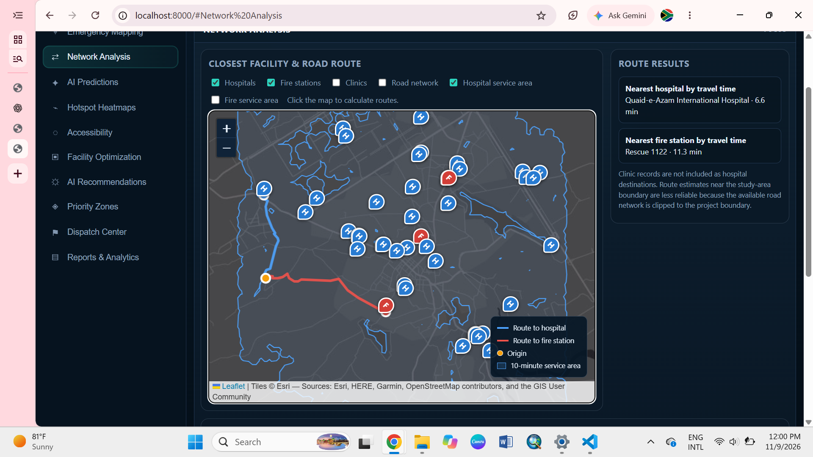
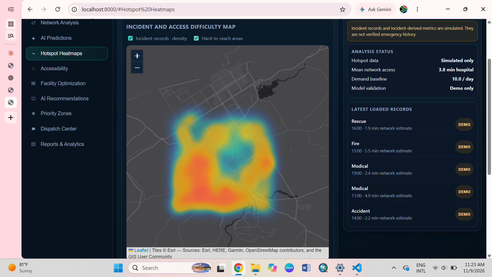
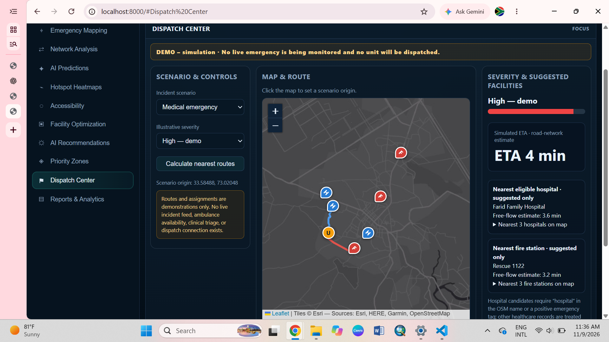
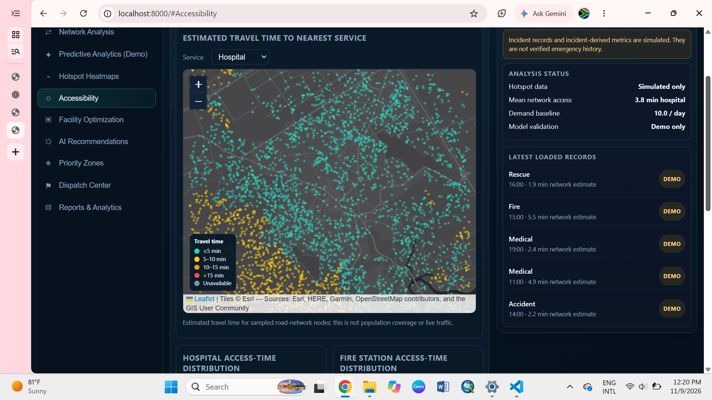
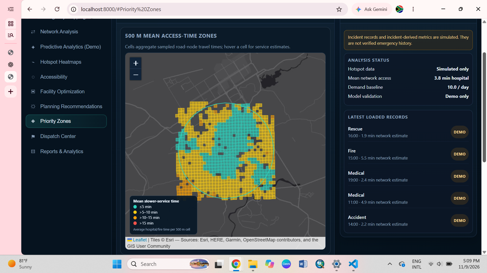
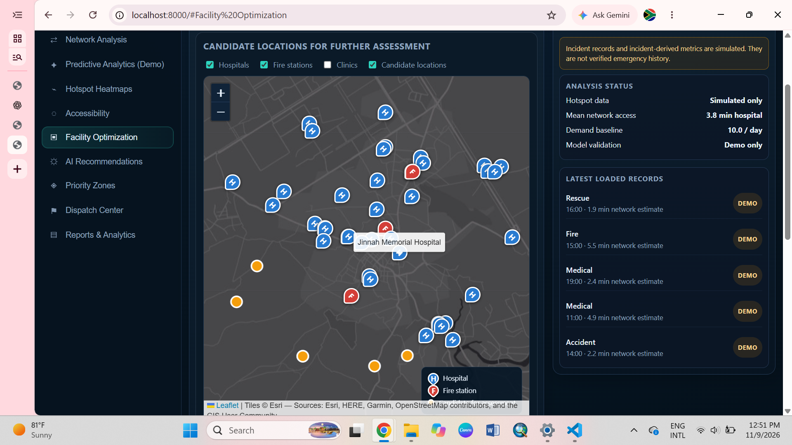
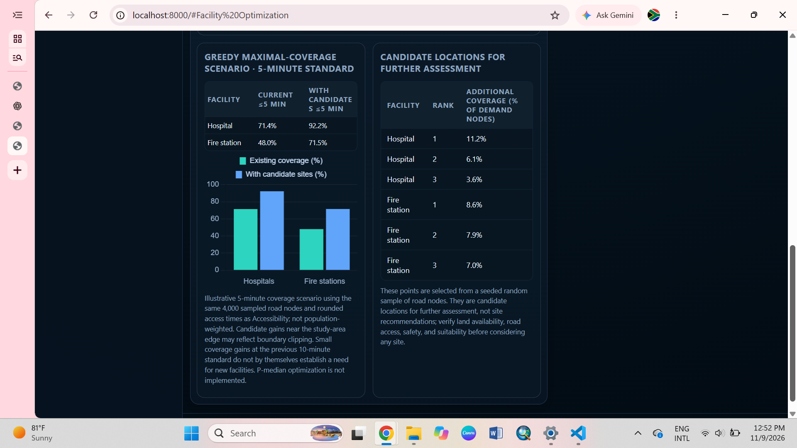
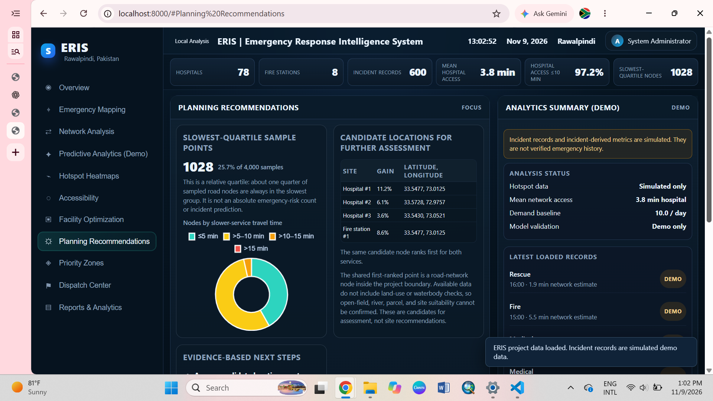
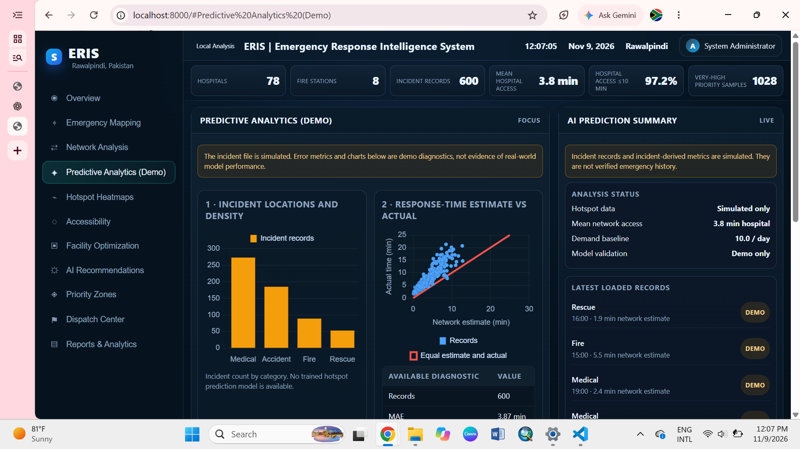
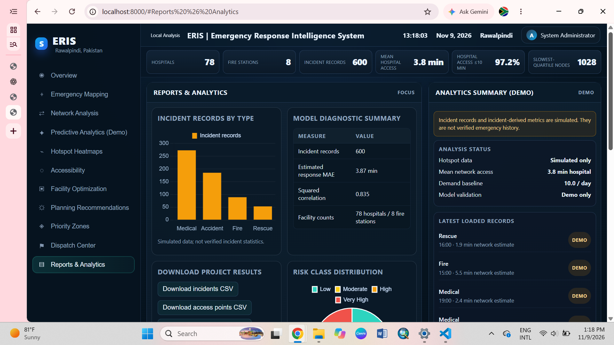

# ERIS: Rawalpindi Emergency Response Intelligence System

**A GIS-based emergency access analysis and decision-support dashboard for hospitals and fire stations in Rawalpindi, Pakistan.**

ERIS uses OpenStreetMap road data to estimate how quickly emergency facilities can be reached, shows where access is weakest, tests candidate sites for new facilities, and presents everything in an interactive web dashboard. It is a **planning and analysis aid, not an operational dispatch system.**

   

> **Data notice:** incident records in this repository are **simulated demo data**. Accuracy figures that depend on them (for example MAE and R²) describe the demo pipeline only and are **not** evidence of real-world model performance. See [Limitations](#limitations).

---

## Table of contents
1. [Project goals](#project-goals)
2. [Dashboard preview](#dashboard-preview)
3. [Key results](#key-results)
4. [Features](#features)
5. [Methodology](#methodology)
6. [Technology stack](#technology-stack)
7. [Project structure](#project-structure)
8. [Installation and usage](#installation-and-usage)
9. [Data sources](#data-sources)
10. [Limitations](#limitations)
11. [Future work](#future-work)
12. [Author and acknowledgements](#author-and-acknowledgements)

---

## Project goals
- Estimate road-network travel time from every part of the study area to the nearest hospital and fire station.
- Identify areas with weaker emergency access using transparent, explainable indicators.
- Test where additional facilities would improve coverage (maximal coverage scenario).
- Provide a professional, interactive dashboard with maps, charts, routes and downloadable results.
- Be explicit about data quality and limitations.

## Dashboard preview
The dashboard has 11 pages. Screenshots below are from the running application.

### Network analysis: closest facility and road routes
Click anywhere on the map to calculate the nearest hospital and fire station by travel time on the road network. Service-area thresholds (5, 10, 15, 20, 30 minutes) can be switched on.



### Hotspot heatmaps
Smooth heat layers for incident density and for hard-to-reach areas.



### Dispatch center (demo simulation)
Choose a scenario, set an origin, and calculate the nearest suggested hospital and fire station with a simulated ETA. This is a routing demonstration only. No unit is dispatched.



### Accessibility
Estimated travel time to the nearest hospital or fire station for sampled road-network nodes, with distribution charts and a threshold coverage chart.



### Priority zones (500 m grid)
Mean slower-service travel time aggregated into 500 m cells, coloured by fixed time bands.



### Facility optimization (5-minute standard)
Greedy maximal-coverage scenario with candidate locations for further assessment.





### Planning recommendations
Evidence-based next steps, candidate locations and access-time bands.



### Predictive analytics (demo)
Incident categories, estimated versus recorded response time, and a weekday-average demand baseline. All values here come from simulated incidents.



### Reports and analytics
Summary tables, CSV downloads, print-to-PDF, data sources and a full limitations section.



## Key results
All figures describe the **sampled road-network nodes inside the study area**, not people or households, and use free-flow travel times.

| Measure | Value |
|---|---|
| Hospitals (OpenStreetMap) | 78 |
| Fire stations (OpenStreetMap) | 8 |
| Mean travel time to nearest hospital | 3.8 min |
| Road nodes within 10 minutes of a hospital | 97.2% |
| Road nodes within 5 minutes of a hospital | about 71% |
| Road nodes within 5 minutes of a fire station | about 48% |
| Hospital coverage within 5 min, existing, then with 3 candidate sites | 71.4% then 92.2% |
| Fire station coverage within 5 min, existing, then with 3 candidate sites | 48.0% then 71.5% |

Candidate gains near the edge of the study area may partly reflect boundary clipping, because facilities and roads just outside the area are not counted.

## Features
- **Overview** with KPI strip, coverage and access-time charts.
- **Emergency mapping** with facility layers, search, nearby facilities and road directions.
- **Network analysis** with closest-facility routes and service areas.
- **Hotspot heatmaps** for incident density and access difficulty.
- **Accessibility** map, histograms and coverage by threshold.
- **Facility optimization** using a greedy maximal-coverage model.
- **Priority zones** on a 500 m grid with fixed time bands.
- **Planning recommendations** written as planning hypotheses, not instructions.
- **Dispatch center** simulation with ETA, severity (rule-based demo) and suggested facilities.
- **Reports and analytics** with CSV export, print/PDF, data sources and limitations.
- Honest **DEMO labels** wherever simulated data is used.

## Methodology
1. **Data collection:** hospitals, fire stations and the drivable road network are downloaded from OpenStreetMap using OSMnx for an 8 km study area around Rawalpindi city centre.
2. **Travel time:** edge speeds come from OSM tags (with a fallback speed), converted to travel time in seconds. A multi-source Dijkstra search on the directed graph gives the time from the nearest facility to every road node.
3. **Service areas:** nodes reachable within 5, 10, 15, 20 and 30 minutes are buffered and merged into polygons.
4. **Access classes:** each node is scored by the worse of its hospital and fire-station access time. Relative quartile classes and fixed time bands are both reported.
5. **Zones:** sampled nodes are aggregated into 500 m grid cells with their mean travel time.
6. **Facility optimization:** a greedy maximal-coverage algorithm selects up to three candidate nodes per service type that add the most newly covered demand nodes (5-minute standard, equal-weight nodes, seeded random candidate sample).
7. **Incidents and diagnostics:** if `data/incidents.csv` exists, real records are used; otherwise a clearly labelled simulated set is generated. Response-time diagnostics compare network estimates with recorded times.
8. **Dashboard:** a local Python server serves the Leaflet and Chart.js dashboard and a route API that returns real road routes.

## Technology stack
| Layer | Tools |
|---|---|
| Data and GIS processing | Python 3.12, OSMnx, NetworkX, GeoPandas, Shapely, pandas, NumPy |
| Analysis | Dijkstra shortest paths, greedy maximal coverage, quartile and band classification |
| Server | Python standard library HTTP server with a route API |
| Frontend | HTML, CSS, JavaScript, Leaflet.js, Chart.js, Leaflet heat layer |
| Basemap | Esri / OpenStreetMap-based tiles with attribution |

## Project structure
```
ERIS_Rawalpindi_Complete/
├── scripts/
│   ├── 01_download_data.py        # OSM boundary, facilities, road graph
│   ├── 02_network_analysis.py     # travel times, KPIs, access classes
│   ├── 03_service_areas.py        # 5 / 10 / 15 / 20 / 30 minute polygons
│   ├── 04_location_optimization.py# greedy maximal-coverage scenario
│   ├── 05_demo_incidents.py       # incidents, stats, demand baseline
│   ├── 06_export_road_network.py  # road network for the dashboard
│   ├── 07_prepare_population.py   # optional population overlay
│   └── common.py                  # shared helpers
├── dashboard/
│   ├── index.html
│   ├── app.js
│   └── data/                      # GeoJSON and JSON outputs
├──                    # README screenshots
├── server.py                      # dashboard and route API
├── run_all.py                     # runs the analysis pipeline
├── requirements.txt
└── README.md
```

## Installation and usage
**Requirements:** Python 3.10 or newer, an internet connection for the first data download.

```bash
# 1. Create and activate a virtual environment (Windows)
python -m venv .venv
.venv\Scripts\activate

# 2. Install dependencies
python -m pip install -r requirements.txt

# 3. Run the analysis pipeline (downloads data, can take several minutes)
python run_all.py

# 4. Start the dashboard and route server
python server.py
```

Then open **http://localhost:8000** in your browser.

**Optional real incident data:** place an anonymised file at `data/incidents.csv` with the columns `lat, lon, type, datetime, response_min` and run `python scripts/05_demo_incidents.py`. The dashboard then shows real results and removes the DEMO labels.

## Data sources
- **OpenStreetMap contributors** for roads, hospitals and fire stations (ODbL licence, https://www.openstreetmap.org/copyright).
- **WorldPop** population surface, used only as an optional map overlay and **not** in the coverage calculations.
- **Esri and OpenStreetMap-based tiles** for the basemap, with attribution shown on every map.
- Incident records are simulated unless you supply your own.

## Limitations
- **Incident records are simulated.** Error metrics, hotspots and demand baselines based on them are demonstrations only.
- **No population weighting in coverage.** Percentages describe sampled road nodes, not people or households.
- **Facilities are community-mapped** in OpenStreetMap and have not been verified against an official hospital or fire-station register. Some healthcare records are treated as clinics and excluded as hospital destinations.
- **Compact study area.** Results describe about an 8 km area around the city centre. Near-complete coverage here does not mean the whole city or district is covered, and routes near the boundary are less reliable because the road graph is clipped.
- **Free-flow travel times.** Live traffic, closures, vehicle restrictions, dispatch delays, facility capacity and unit availability are not modelled.
- **Facility optimization is illustrative.** It uses equal-weight nodes and randomly sampled candidate nodes. Candidates are for further assessment, not site recommendations. P-median optimization is not implemented.
- **Quartile classes are relative.** About a quarter of nodes always fall in the slowest group, so they are not an absolute risk measure.
- The dispatch screen is a **simulation**, and its severity score is a simple rule, not clinical triage.

## Future work
- Replace simulated incidents with anonymised official records (for example Rescue 1122) and validate the response-time estimates.
- Weight demand by population (WorldPop) so coverage describes people.
- Verify the facility list against an official register and add capacity and services.
- Extend the road network beyond the study boundary to remove edge effects.
- Add p-median and capacitated location models.
- Add traffic-aware travel times.

## Author and acknowledgements
Created by **Rameen Naeem** ([@rameennaeemgeo](https://github.com/rameennaeemgeo)), geoinformatics (Remote Sensing and GIS) student, as a portfolio project.

Built with open data and open-source tools: OpenStreetMap, OSMnx, NetworkX, GeoPandas, Leaflet and Chart.js.
